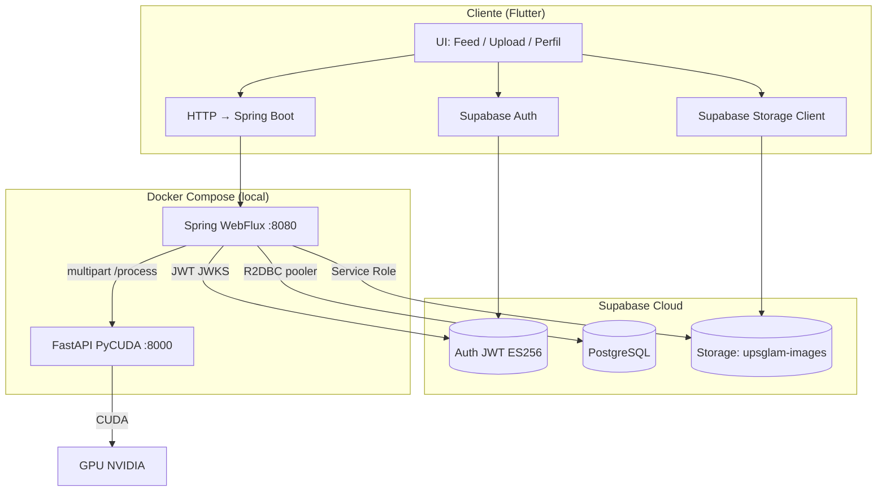
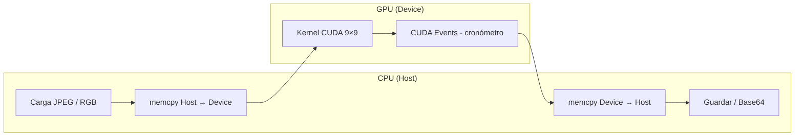
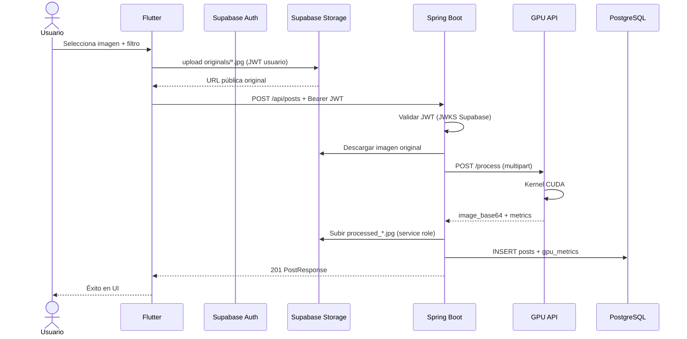
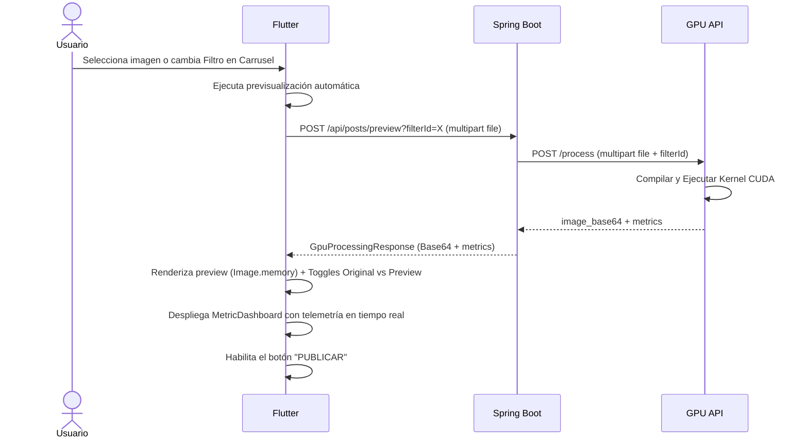
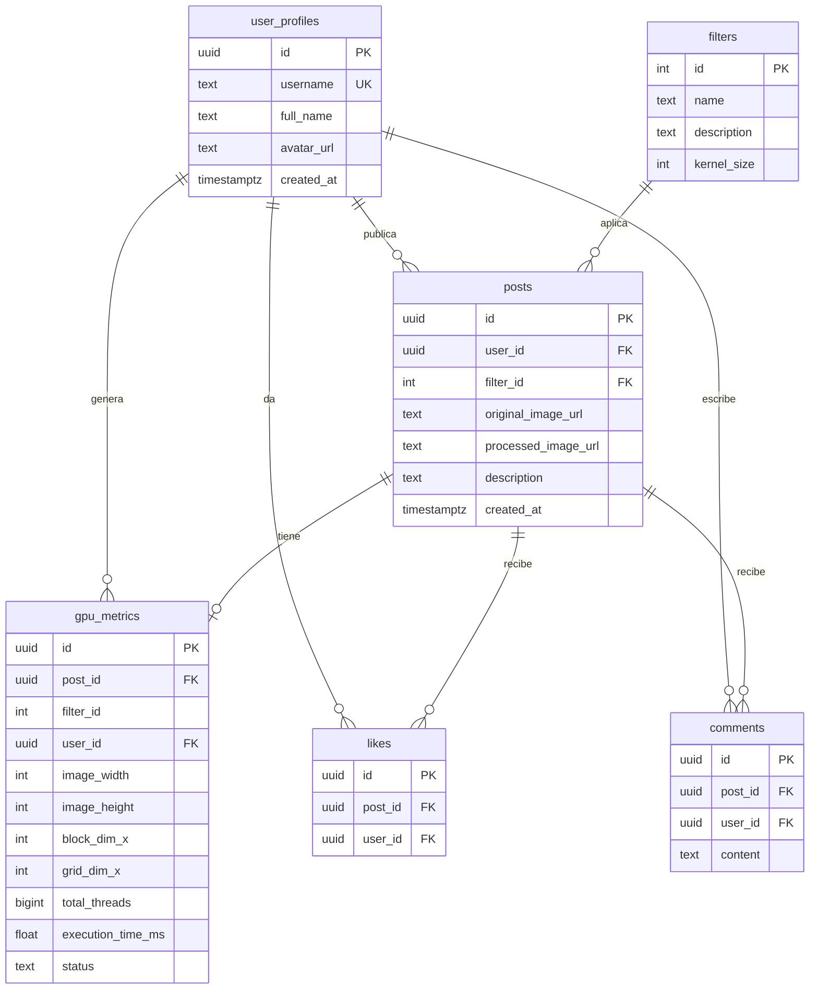
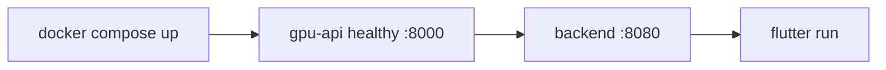

# UPSGlam: Heterogeneous GPU-Accelerated Image Processing Platform

[](https://developer.nvidia.com/cuda-zone)
[](https://fastapi.tiangolo.com/)
[](https://spring.io/)
[](https://flutter.dev/)
[](https://www.docker.com/)
[](https://supabase.com/)

> **Plataforma distribuida de procesamiento fotográfico de alto rendimiento con aceleración masiva en GPU (CUDA) y arquitectura de microservicios desacoplada.**

---

## Resumen de Ingeniería

El procesamiento y filtrado convolucional sobre imágenes de alta resolución (4K / 8K) impone un cuello de botella severo cuando se ejecuta secuencialmente en la CPU. En aplicaciones con alta concurrencia, esto degrada los tiempos de respuesta y eleva exponencialmente los costos computacionales.

**UPSGlam** aborda este desafío implementando una **arquitectura distribuida y heterogénea**, donde:
* Las tareas de coordinación, autenticación, control de acceso y persistencia transaccional se ejecutan en un backend empresarial robusto en **Java 17 / Spring Boot**.
* Las operaciones de convolución matricial bidimensional se delegan a un microservicio especializado en **Python / FastAPI** que invoca **kernels CUDA personalizados** compilados directamente sobre la GPU NVIDIA mediante **PyCUDA**.
* Un cliente multiplataforma construido en **Flutter (Dart)** proporciona una experiencia de usuario interactiva y fluida con edición y previsualización en tiempo real.

---

## Tabla de contenidos

1. [Introducción](#1-introducción)
2. [Objetivos del proyecto](#2-objetivos-del-proyecto)
3. [Arquitectura general](#3-arquitectura-general)
4. [Stack tecnológico](#4-stack-tecnológico)
5. [Estructura del repositorio](#5-estructura-del-repositorio)
6. [Metodología de procesamiento GPU](#6-metodología-de-procesamiento-gpu)
7. [Flujo de publicación (pipeline)](#7-flujo-de-publicación-pipeline)
8. [Microservicios y APIs](#8-microservicios-y-apis)
9. [Base de datos y almacenamiento](#9-base-de-datos-y-almacenamiento)
10. [Seguridad y autenticación](#10-seguridad-y-autenticación)
11. [Requisitos previos](#11-requisitos-previos)
12. [Configuración del entorno](#12-configuración-del-entorno)
13. [Ejecución del sistema](#13-ejecución-del-sistema)
14. [Modo académico: benchmark CPU vs GPU](#14-modo-académico-benchmark-cpu-vs-gpu)
15. [Frontend Flutter](#15-frontend-flutter)
16. [Despliegue con Docker](#16-despliegue-con-docker)
17. [Solución de problemas](#17-solución-de-problemas)
18. [Roadmap y trabajo futuro](#18-roadmap-y-trabajo-futuro)
19. [Referencias](#19-referencias)

---

## 1. Introducción

**UPSGlam** es una aplicación tipo red social centrada en la **edición y publicación de fotografías procesadas en tiempo casi real mediante kernels CUDA**. A diferencia de un filtro puramente cosmético en el cliente, el núcleo del sistema delega el cómputo intensivo a una **GPU NVIDIA** a través de un microservicio Python (**PyCUDA**), orquestado por un backend reactivo en **Spring WebFlux** y consumido desde una app multiplataforma **Flutter**.

El proyecto integra tres líneas de estudio:

| Dimensión | Descripción |
|-----------|-------------|
| **Paralelismo / GPU** | Convoluciones 2D 9×9 en CUDA, comparación con CPU (Numba JIT), métricas de hilos y tiempo de kernel |
| **Arquitectura de software** | Microservicios, API REST, BaaS (Supabase), contenedores Docker |
| **Experiencia de usuario** | Feed, perfiles, publicación con feedback visual del pipeline heterogéneo |

La aplicación no solo muestra la imagen resultante: registra y expone **métricas de hardware** (dimensiones del grid, bloques, hilos totales, tiempo de ejecución en milisegundos) asociadas a cada publicación, alineadas con el enfoque académico del curso de computación paralela.

---

## 2. Objetivos del proyecto

### Objetivo general

Diseñar e implementar una plataforma distribuida que aplique **filtros de imagen mediante programación paralela en GPU**, validando resultados frente a una implementación CPU optimizada y exponiendo el rendimiento al usuario final.

### Objetivos específicos

- Implementer kernels CUDA para **siete filtros** avanzados basados en convolución 9×9 e hilos paralelos: bordes (gris), enfoque (RGB), estilo cartoon, sepia, invertido, pixelado y burbujas con marco de agua.
- Comparar tiempos de ejecución **CPU (Numba)** vs **GPU (PyCUDA)** en el módulo de laboratorio (`main.py`).
- Exponer el procesamiento como **API REST** (`api.py`) integrable en un flujo productivo.
- Orquestar el flujo completo: autenticación → almacenamiento → GPU → persistencia → feed.
- Documentar arquitectura, esquema de datos y procedimientos de despliegue.

---

## 3. Arquitectura general

### 3.1 Vista de componentes



### 3.2 Principios de diseño

| Principio | Aplicación en UPSGlam |
|-----------|------------------------|
| **Separación de responsabilidades** | Flutter: UX y auth; Spring: orquestación; Python: cómputo GPU; Supabase: persistencia y archivos |
| **Procesamiento heterogéneo** | CPU prepara I/O; GPU ejecuta convolución masiva paralela |
| **Seguridad en capas** | JWT en Spring; RLS en Storage; clave service solo en backend |
| **Reactividad** | Spring WebFlux + R2DBC no bloqueante hacia PostgreSQL |

### 3.3 Puertos y servicios

| Servicio | Puerto | Protocolo | Descripción |
|----------|--------|-----------|-------------|
| `upsglam-gpu-api` | 8000 | HTTP | Microservicio PyCUDA / FastAPI |
| `upsglam-backend` | 8080 | HTTP | API orquestadora Spring Boot |
| Flutter Web | variable | HTTP | Consume `localhost:8080` |
| Supabase | 443 | HTTPS | Auth, DB, Storage |

---

## 4. Stack tecnológico

### 4.1 Capa de presentación

| Tecnología | Versión / notas |
|------------|-----------------|
| **Flutter** | SDK ^3.11 |
| **Dart** | Incluido con Flutter |
| **supabase_flutter** | Auth, queries PostgREST, Storage |
| **http** | Llamadas al backend Spring |
| **image_picker** | Cámara / galería |
| **google_fonts** | Tipografía (Outfit, Share Tech Mono) |

Plataformas soportadas en el proyecto: **Web**, **Android**, **iOS**, **Windows**, **Linux**, **macOS** (estructura estándar Flutter).

### 4.2 Capa de orquestación

| Tecnología | Versión / notas |
|------------|-----------------|
| **Java** | 21 |
| **Spring Boot** | 4.0.6 |
| **Spring WebFlux** | API reactiva |
| **Spring Data R2DBC** | Acceso a PostgreSQL |
| **Spring Security OAuth2 Resource Server** | Validación JWT Supabase (JWKS) |
| **Lombok** | DTOs y modelos |
| **WebClient** | Cliente reactivo hacia GPU y Storage |

### 4.3 Capa de cómputo GPU

| Tecnología | Versión / notas |
|------------|-----------------|
| **Python** | 3.x (imagen Docker Ubuntu 22.04) |
| **PyCUDA** | 2024.1 |
| **NumPy** | &lt; 2.0 |
| **Numba** | CPU baseline en `main.py` |
| **FastAPI + Uvicorn** | API de producción |
| **Pillow** | Carga/guardado JPEG |
| **CUDA** | 12.3.1 (imagen `nvidia/cuda:12.3.1-devel`) |

### 4.4 Infraestructura y BaaS

| Tecnología | Uso |
|------------|-----|
| **Supabase** | PostgreSQL, Auth, Storage, RLS |
| **Docker / Docker Compose** | GPU API + Backend |
| **NVIDIA Container Toolkit** | GPU dentro del contenedor |

---

## 5. Estructura del repositorio

```
Proyecto Interciclo CP/
├── venv/                          # Entorno Python auxiliar (opcional, raíz)
└── pycuda/                        # ★ Proyecto principal UPSGlam
    ├── README.md                  # Este documento
    ├── .env                       # Secretos locales (NO versionar)
    ├── .env.example               # Plantilla de variables
    ├── docker-compose.yml         # gpu-api + backend
    ├── Dockerfile.cuda            # Imagen GPU (nvcc + PyCUDA)
    ├── requirements.txt           # Dependencias Python
    │
    ├── main.py                    # Laboratorio: benchmark CPU vs GPU
    ├── api.py                     # Microservicio FastAPI (/process)
    ├── filtros.py                 # Kernels 9×9 (NumPy)
    │
    ├── backend/                   # Spring Boot WebFlux
    │   ├── pom.xml
    │   ├── Dockerfile.backend
    │   └── src/main/java/
    │       ├── upsglam_backend/BackendApplication.java
    │       └── ec/edu/ups/backend/
    │           ├── config/        # Security, WebClient
    │           ├── controller/    # PostController
    │           ├── service/       # Post, PyCuda, Storage
    │           ├── repository/    # R2DBC
    │           ├── model/         # Entidades
    │           └── dto/           # Request/Response
    │
    ├── frontend/                  # Flutter UPSGlam
    │   ├── pubspec.yaml
    │   └── lib/
    │       ├── main.dart
    │       ├── core/theme.dart
    │       ├── models/post.dart
    │       ├── services/          # supabase_service, backend_service
    │       ├── screens/           # login, feed, upload, profile...
    │       └── widgets/           # post_card, metric_dashboard
    │
    └── supabase/                  # Scripts SQL de referencia
        ├── schema_reference.sql
        └── storage_policies.sql
```

### 5.1 Responsabilidad por archivo clave

| Archivo | Rol |
|---------|-----|
| `main.py` | Script académico: carga `input.jpg`, ejecuta 3 filtros en CPU y GPU, valida pixel a pixel, imprime speedup |
| `api.py` | Servicio HTTP: recibe imagen + `filter_id`, devuelve JPEG en Base64 y métricas CUDA |
| `filtros.py` | Definición de matrices de convolución 9×9 |
| `PostService.java` | Orquesta: descarga → GPU → subida procesada → INSERT post + métricas |
| `upload_screen.dart` | UI de publicación y pipeline visual |
| `backend_service.dart` | `POST /api/posts` y lectura del feed vía Supabase |

---

## 6. Metodología de procesamiento GPU

### 6.1 Modelo de paralelismo

Cada **píxel de salida** se calcula en un hilo CUDA independiente (mapeo 1D → coordenadas `(x, y)`). La convolución usa un kernel espacial **9×9** con borde tratado por **clamping** (vecinos fuera de imagen se clampan al borde).



### 6.2 Configuración de lanzamiento CUDA

| Parámetro | Valor | Significado |
|-----------|-------|-------------|
| `blockDim` | `(256, 1, 1)` | 256 hilos por bloque en X |
| `gridDim` | `⌈(W×H) / 256⌉` | Bloques necesarios para cubrir todos los píxeles |
| `total_threads` | `gridDim.x × 256` | Métrica expuesta al feed (puede incluir hilos ociosos en el último bloque) |

### 6.3 Filtros implementados

Los primeros tres filtros aplican convolución espacial con matrices 9x9, mientras que los cuatro filtros avanzados realizan transformaciones de canal y operaciones de fusión paralela:

| ID | Nombre | Kernel central / Operación | Modo | Función CUDA |
|----|--------|----------------------------|------|--------------|
| **1** | Bordes | 80 (Laplaciano discreto 9x9) | Escala de grises (1 canal) | `convolucionGPU_Gris` |
| **2** | Enfoque | 81 (Unsharp Masking 9x9) | RGB (3 canales) | `convolucionGPU_RGB` |
| **3** | Cartoon | 80 (9x9 + aplanado color) | RGB + cuantización `/64` | `cartoon_GPU` |
| **4** | Sepia | Matriz de color cálida | Transformación lineal RGB | `sepia_GPU` |
| **5** | Invertido | Negativo: `255 - pixel` | Inversión de color completa | `negative_GPU` |
| **6** | Pixelado | Mosaicos de 16x16 píxeles | Agrupación y promedio espacial | `pixelate_GPU` |
| **7** | Burbujas Isotipo | Borde bicolor + 8 logos con 30% alpha | Fusión y mezcla de canales paralela | `custom_bubbles_GPU` |

Definición en `filtros.py`:

```python
# Ejemplo: kernel de bordes (centro en índice 40 de matriz 9×9 aplanada)
kernelBordes = np.full(81, -1.0, dtype=np.float32)
kernelBordes[40] = 80.0
```

### 6.4 Validación CPU vs GPU (`main.py`)

Para el informe académico, cada filtro se ejecuta en:

1. **CPU** con **Numba `@njit`** (compilación JIT a código máquina eficiente).
2. **GPU** con **PyCUDA** y eventos CUDA para medición precisa.

La función `verificar_resultados` comprueba que la diferencia por píxel sea ≤ 1 (tolerancia por redondeo float → uint8).

### 6.5 Concurrencia en `api.py`

FastAPI atiende peticiones en un **thread pool**. PyCUDA requiere un **contexto CUDA por hilo**, por lo que el servicio usa un **`ThreadPoolExecutor` de un solo worker** que:

1. Inicializa CUDA y compila `SourceModule` una vez.
2. Serializa todas las peticiones `/process` en ese hilo.

Esto evita errores como `invalid resource handle` o `invalid device context`.

---

## 7. Flujo de publicación (pipeline)

### 7.1 Diagrama de secuencia



### 7.2 Lectura del feed

El feed **no pasa por Spring**: Flutter consulta directamente Supabase con un `select` relacional:

- `posts`
- `user_profiles` (username, avatar)
- `gpu_metrics` (métricas CUDA)

Esto reduce carga en el backend y aprovecha las políticas RLS de Supabase para lectura.

### 7.3 Flujo de Previsualización en Vivo

Para permitir a los usuarios observar el resultado de los filtros GPU antes de realizar una publicación formal en la red social, implementamos un flujo automático, efímero y ultra performante:



Este flujo evita escribir registros en base de datos o subir archivos permanentes a Supabase Storage durante la fase exploratoria del usuario. Todo el feedback del proceso en pantalla se realiza en texto limpio de emojis para garantizar un acabado profesional en la consola de carga.

---

## 8. Microservicios y APIs

### 8.1 GPU API (`api.py`) — puerto 8000

| Método | Ruta | Descripción |
|--------|------|-------------|
| `GET` | `/` | Health check + nombre de GPU |
| `POST` | `/process` | Procesa imagen |

**Request `POST /process`:**

| Campo | Tipo | Descripción |
|-------|------|-------------|
| `file` | multipart file | Imagen (JPEG/PNG) |
| `filter_id` | form int | `1` Bordes, `2` Enfoque, `3` Cartoon |

**Response exitosa (200):**

```json
{
  "status": "SUCCESS",
  "image_base64": "<JPEG en Base64>",
  "metrics": {
    "filter_id": 1,
    "image_width": 1920,
    "image_height": 1080,
    "block_dim_x": 256,
    "grid_dim_x": 8100,
    "total_threads": 2073600,
    "execution_time_ms": 12.3456
  }
}
```

### 8.2 Backend Spring — puerto 8080

| Método | Ruta | Auth | Descripción |
|--------|------|------|-------------|
| `POST` | `/api/posts` | Bearer JWT | Crea publicación (pipeline completo) |
| `POST` | `/api/posts/preview` | Bearer JWT | Previsualiza imagen y obtiene telemetría efímera (multipart) |

**Request `POST /api/posts/preview` (Multipart Form Data):**

* `file`: Archivo de imagen (JPEG/PNG).
* `filterId`: Entero del 1 al 7.

**Response (200) `GpuProcessingResponse`:**

```json
{
  "status": "SUCCESS",
  "image_base64": "<JPEG procesado codificado en Base64>",
  "metrics": {
    "filter_id": 4,
    "image_width": 1024,
    "image_height": 1024,
    "block_dim_x": 256,
    "grid_dim_x": 4096,
    "total_threads": 1048576,
    "execution_time_ms": 8.7654
  }
}
```

**Request body (`PostCreateRequest` para `/api/posts`):**

```json
{
  "originalImageUrl": "https://.../storage/v1/object/public/upsglam-images/originals/original_123.jpg",
  "filterId": 1,
  "description": "Pie de foto opcional"
}
```

**Response (201):** objeto `PostResponse` con URLs, usuario, filtro y contadores sociales.

---

## 9. Base de datos y almacenamiento

### 9.1 Diagrama entidad-relación



Script SQL de referencia: [`supabase/schema_reference.sql`](supabase/schema_reference.sql).

### 9.2 Supabase Storage

| Bucket | Visibilidad | Rutas | Uso |
|--------|-------------|-------|-----|
| `upsglam-images` | Público | `originals/*` | Subida desde Flutter (usuario autenticado) |
| `upsglam-images` | Público | `processed_*` | Subida desde backend (service role) |

Políticas RLS: [`supabase/storage_policies.sql`](supabase/storage_policies.sql).

### 9.3 Conexión R2DBC (importante)

Spring **no** usa la URI `postgresql://` de Supabase directamente. Debes separar:

```properties
# Formato correcto para Spring R2DBC
spring.r2dbc.url=r2dbc:postgresql://aws-1-us-east-1.pooler.supabase.com:6543/postgres?sslMode=require
spring.r2dbc.username=postgres.<project-ref>
spring.r2dbc.password=<database-password>
```

Usa el **Transaction pooler** (puerto **6543**), no el host directo `db.*.supabase.co` (suele ser solo IPv6 y falla en Docker).

---

## 10. Seguridad y autenticación

### 10.1 Flutter → Supabase

- Registro e inicio de sesión vía **Supabase Auth** (email/password).
- El `access_token` JWT se envía a Spring en `Authorization: Bearer ...`.

### 10.2 Spring → validación JWT

Supabase firma tokens con **ES256** (JWT Signing Keys). Spring valida mediante **JWKS**:

```
https://<project-ref>.supabase.co/auth/v1/.well-known/jwks.json
```

Configuración en `SecurityConfig.java` → `ReactiveJwtDecoders.fromIssuerLocation(...)`.

> El **Legacy JWT Secret** (HS256) del panel de Supabase **no** valida los `access_token` de login actuales.

### 10.3 Backend → Supabase Storage

`SupabaseStorageService` usa la **Service Role Key** solo en servidor para subir imágenes procesadas.

### 10.4 Buenas prácticas

- No versionar `.env` ni claves en `main.dart`.
- Rotar contraseñas si se exponen en repositorios o chats.
- Mantener `service-key` únicamente en el backend.

---

## 11. Requisitos previos

### Hardware

- PC con **GPU NVIDIA** compatible con CUDA 12.x
- Drivers NVIDIA actualizados
- (Recomendado) 8 GB+ RAM

### Software

| Herramienta | Propósito |
|-------------|-----------|
| **Docker Desktop** + WSL2 (Windows) | Contenedores gpu-api y backend |
| **NVIDIA Container Toolkit** | Pasar GPU al contenedor |
| **Flutter SDK** | Cliente móvil/web |
| **Java 21** | Compilar backend localmente (opcional) |
| **Maven** | Incluido vía `mvnw` |
| Cuenta **Supabase** | Auth, DB, Storage |

---

## 12. Configuración del entorno

### 12.1 Supabase

1. Crear proyecto en [Supabase](https://supabase.com).
2. Ejecutar [`supabase/schema_reference.sql`](supabase/schema_reference.sql) en SQL Editor (ajustar según tu esquema real).
3. Crear bucket **`upsglam-images`** (público).
4. Ejecutar [`supabase/storage_policies.sql`](supabase/storage_policies.sql).
5. En **Authentication**: habilitar email; configurar confirmación según necesidad.
6. Copiar credenciales: URL, anon key, service role key, database password.
7. Obtener **Transaction pooler** URI y convertirla al formato R2DBC (ver sección 9.3).

### 12.2 Archivo `.env`

```bash
cp .env.example .env
# Editar .env con tus valores reales
```

Ejemplo de estructura (sin secretos reales):

```env
SPRING_R2DBC_URL=r2dbc:postgresql://aws-1-us-east-1.pooler.supabase.com:6543/postgres?sslMode=require
SPRING_R2DBC_USERNAME=postgres.ovatryxuymnmceyiiuph
SPRING_R2DBC_PASSWORD=***

UPSGLAM_SUPABASE_URL=https://ovatryxuymnmceyiiuph.supabase.co
UPSGLAM_SUPABASE_ANON_KEY=***
UPSGLAM_SUPABASE_SERVICE_KEY=***
UPSGLAM_GPU_API_URL=http://gpu-api:8000
```

### 12.3 Flutter (`frontend/lib/main.dart`)

Configurar `Supabase.initialize` con tu `url` y `anonKey` del proyecto.

### 12.4 URL del backend en Flutter

`backend_service.dart` selecciona automáticamente:

| Plataforma | URL base |
|------------|----------|
| Web / Desktop | `http://localhost:8080` |
| Android emulador | `http://10.0.2.2:8080` |

---

## 13. Ejecución del sistema

### 13.1 Arranque completo (recomendado)

```bash
cd pycuda
docker compose up --build
```

En otra terminal:

```bash
cd pycuda/frontend
flutter pub get
flutter run -d chrome   # o android, windows, etc.
```

### 13.2 Verificación rápida

```bash
# GPU API
curl http://localhost:8000/

# Backend (requiere JWT para /api/posts)
curl http://localhost:8080/api/posts
# → 401 sin token es esperado
```

### 13.3 Orden de dependencias



---

## 14. Modo académico: benchmark CPU vs GPU

Para experimentos de laboratorio **sin** Docker ni Flutter:

1. Colocar una imagen `input.jpg` en la carpeta `pycuda/`.
2. Activar entorno Python con dependencias de `requirements.txt`.
3. Ejecutar:

```bash
python main.py
```

Salida esperada:

- Tiempos CPU y GPU por filtro.
- Factor de aceleración (speedup).
- Verificación `CORRECTA` CPU vs GPU.
- Archivos `resultado_Bordes.jpg`, `resultado_Enfoque.jpg`, `resultado_Cartoon.jpg`.

---

## 15. Frontend Flutter

### 15.1 Pantallas

| Pantalla | Archivo | Función |
|----------|---------|---------|
| Login | `login_screen.dart` | Email / password |
| Registro | `signup_screen.dart` | Alta con metadata de perfil |
| Navegación | `navigation_screen.dart` | Bottom bar: Inicio / Publicar / Perfil |
| Feed | `feed_screen.dart` | Lista de posts con métricas GPU |
| Publicar | `upload_screen.dart` | Pipeline de previsualización interactiva GPU (con toggles original/procesado), dashboard de telemetría CUDA y publicación definitiva simple (sin emojis) |
| Perfil | `profile_screen.dart` | Cuadrícula de publicaciones del usuario |

### 15.2 Widgets destacados

- **`PostCard`**: tarjeta de publicación con imagen procesada.
- **`MetricDashboard`**: panel estilo consola con métricas CUDA (hilos, grid, tiempo ms).

### 15.3 Tema visual

`core/theme.dart` — tema oscuro con acentos violeta/cian, tipografía **Outfit** y fuente monoespaciada para métricas técnicas.

---

## 16. Despliegue con Docker

### 16.1 Servicios definidos

```yaml
# docker-compose.yml (resumen)
services:
  gpu-api:    # NVIDIA CUDA 12.3 devel + PyCUDA + uvicorn
  backend:    # Spring Boot fat JAR, depende de gpu-api
```

### 16.2 Dockerfile GPU (`Dockerfile.cuda`)

- Base: `nvidia/cuda:12.3.1-devel-ubuntu22.04` (incluye `nvcc` para compilar kernels en runtime).
- Expone puerto **8000**.
- Comando: `uvicorn api:app --host 0.0.0.0 --port 8000`.

### 16.3 Dockerfile Backend (`backend/Dockerfile.backend`)

- Build multi-stage: Maven + Temurin 21.
- Artefacto: `app.jar` en puerto **8080**.

---

## 17. Solución de problemas

| Síntoma | Causa probable | Solución |
|---------|----------------|----------|
| `403` Storage al subir original | Sin políticas RLS en bucket | Ejecutar `storage_policies.sql` |
| `401` en `/api/posts` | JWT inválido o validación HS256 legacy | Usar JWKS (`SecurityConfig` actual) |
| `500` desde GPU `invalid resource handle` | Contexto CUDA en hilo incorrecto | Usar `api.py` con executor de 1 hilo |
| Backend no arranca: `does not start with r2dbc scheme` | URL `postgresql://` en `.env` | Cambiar a `r2dbc:postgresql://host:6543/...` |
| `UnknownHostException` para `db.*.supabase.co` | Host directo solo IPv6 | Usar **transaction pooler** |
| Flutter `Unexpected end of JSON` en error | Body vacío en 401/500 | Manejo mejorado en `backend_service.dart` |
| Imágenes en bucket pero error en app | Fallo al guardar en PostgreSQL | Revisar `.env` R2DBC y logs `docker logs upsglam-backend` |

### Logs útiles

```bash
docker logs upsglam-gpu-api --tail 50
docker logs upsglam-backend --tail 50
```

---

## 18. Roadmap y trabajo futuro

Funcionalidad completada e integrada con éxito:

- [x] Likes y Reacciones en tiempo real (`likes` table e inserción reactiva de notificaciones)
- [x] Bandeja de Comentarios interactiva con notificaciones en vivo (`comments` table)
- [x] Catálogo de 7 filtros GPU en carrusel
- [x] Previsualización en vivo efímera con Base64 y telemetría en tiempo real antes de publicar
- [x] Toggles Original vs Vista Previa de la GPU en caliente en la UI de Flutter
- [x] Pipeline sin emojis en impresiones de procesamiento para dar feedback limpio al usuario

Funcionalidad planificada para el futuro:

- [ ] Tests automatizados (JUnit, integración GPU mock)
- [ ] CI/CD con runner GPU
- [ ] Variables de entorno en Flutter vía `--dart-define` (evitar claves hardcodeadas)

---

## 19. Referencias

- [Documentación PyCUDA](https://documen.tician.de/pycuda/)
- [Numba JIT](https://numba.pydata.org/)
- [Spring WebFlux](https://docs.spring.io/spring-framework/reference/web/webflux.html)
- [Spring Data R2DBC](https://spring.io/projects/spring-data-r2dbc)
- [Supabase Docs](https://supabase.com/docs)
- [Flutter Documentation](https://docs.flutter.dev/)
- NVIDIA CUDA C Programming Guide — modelo de ejecución grid/block/thread

---

## Licencia y autoría

Proyecto académico — **Universidad Politécnica Salesiana (UPS)**.  
Uso educativo. Ajustar licencia y créditos de autores según requisitos del curso.

---

**UPSGlam** — *Procesamiento de imágenes en GPU, visible y medible.*
